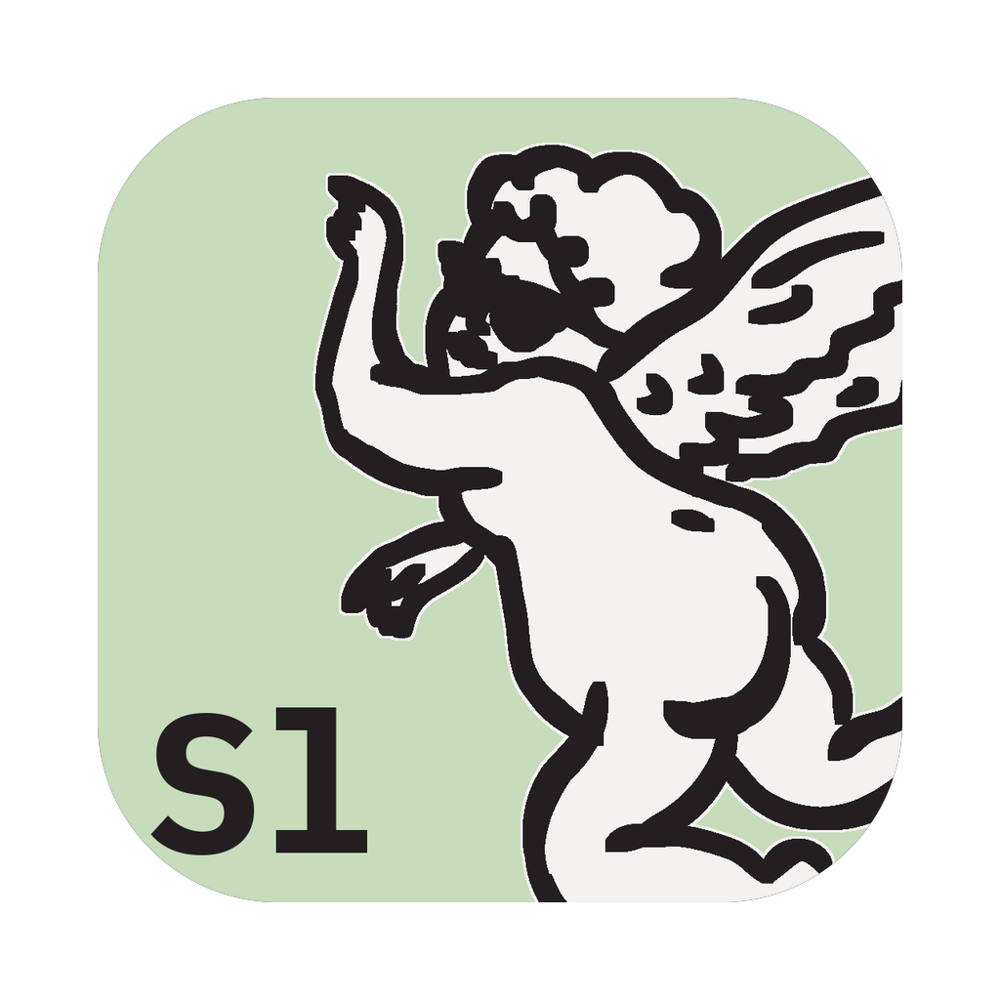

<!-- Modified-by: FreeANDIY (Free Andy Agency), 2026. Replaces upstream DeckCraft's README. -->
<p align="center">
  
</p>

<h1 align="center">FreeANDIY Slides</h1>

<p align="center">
  <b>A free, open-source presentation editor. Native Rust, runs on macOS, Windows, Linux and in the browser.</b><br>
  Part of <a href="https://freeandiy.freeandy.agency">FreeANDIY</a>, free creative and office apps by Free Andy Agency.
</p>

---

## About

FreeANDIY Slides makes presentations and slide shows: themes and layouts, text, shapes,
pictures, video and audio, transitions and animations, presenter view, and PPTX and PDF import and
export. It is a native egui app (no webview), and the web version is the same Rust code compiled
to WebAssembly.

Every action is a command, so the app can be driven from a CLI (`freeandiy-slides-cli`), a JSON
control channel or an MCP server.

**FreeANDIY Slides is based on the open-source project
[DeckCraft](https://github.com/storytold/deckcraft) (© ArtCraft Team and contributors,
MIT/Apache-2.0). FreeANDIY is not affiliated with the ArtCraft team.** The editor itself is their
work; FreeANDIY adds its own branding, packaging and translations, and follows upstream closely.

## Download

Builds for macOS, Windows and Linux are published on the
[Releases](https://github.com/FreeAndy21/freeandiy-slides/releases) page as
`freeandiy-slides-<version>-<os>-<arch>.*`.

## Build from source

Requires Rust (see `rust-version` in `Cargo.toml`).

```sh
cargo run --release -p deckcraft                         # desktop app (binary: freeandiy-slides)
cargo run --release -p deckcraft-cli -- --help           # CLI (binary: freeandiy-slides-cli)
cd apps/deckcraft-web && trunk build --release           # web build (WebAssembly)
```

The crate names keep upstream's `deckcraft-*`, and documents keep the `.deckcraft` format, so
upstream changes merge cleanly and files open in both. The developer documentation in `docs/` is
upstream's and still says DeckCraft.

## How this fork is made

Everything FreeANDIY changes lives in [`freeandiy/`](freeandiy/): the brand definition
(`branding.toml`, `app.toml`), assets, a handful of small patches and text rules. All other files
are regenerated from upstream DeckCraft by `freeandiy/scripts/regenerate.sh`, so updates from
upstream never conflict. See [`freeandiy/docs/upstream-sync.md`](freeandiy/docs/upstream-sync.md).

Issues with FreeANDIY builds go to
[our tracker](https://github.com/FreeAndy21/freeandiy-slides/issues), not to upstream.

## License

The code is licensed, like upstream, under either of [MIT](LICENSE-MIT) or
[Apache-2.0](LICENSE-APACHE) at your option. See [`NOTICE`](NOTICE) and [`ATTRIBUTION.md`](ATTRIBUTION.md)
for third-party material.

The FreeANDIY and Free Andy Agency names, the angel Andy, logos and app icons are © Free Andy
Agency and **not** covered by the code license; see
[`freeandiy/assets/brand/LICENSE-brand.txt`](freeandiy/assets/brand/LICENSE-brand.txt).

<sub>Microsoft and PowerPoint are trademarks or registered trademarks of Microsoft Corporation in the United
States and/or other countries. FreeANDIY Slides is an independent, open-source project and is not
affiliated with, sponsored by or endorsed by Microsoft Corporation; these names are used only to describe the
workflows it is compatible with.</sub>
